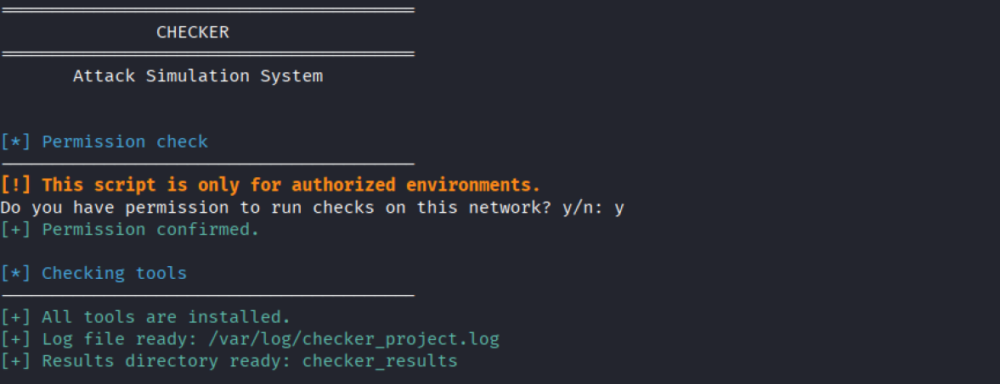
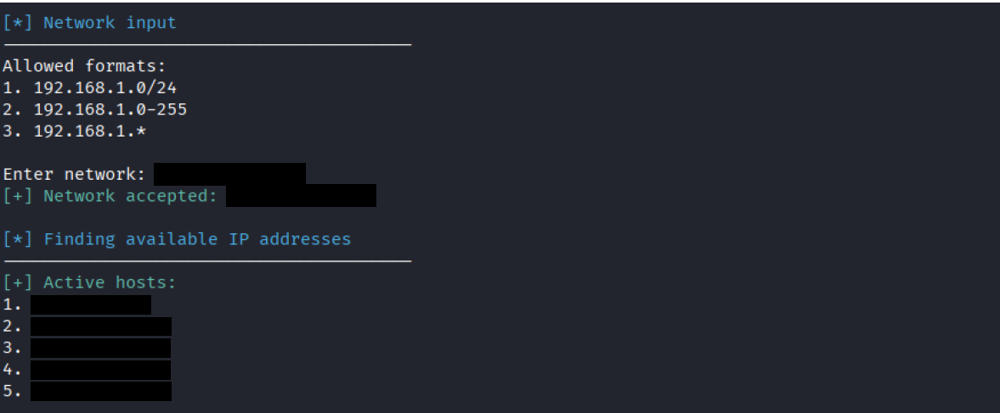
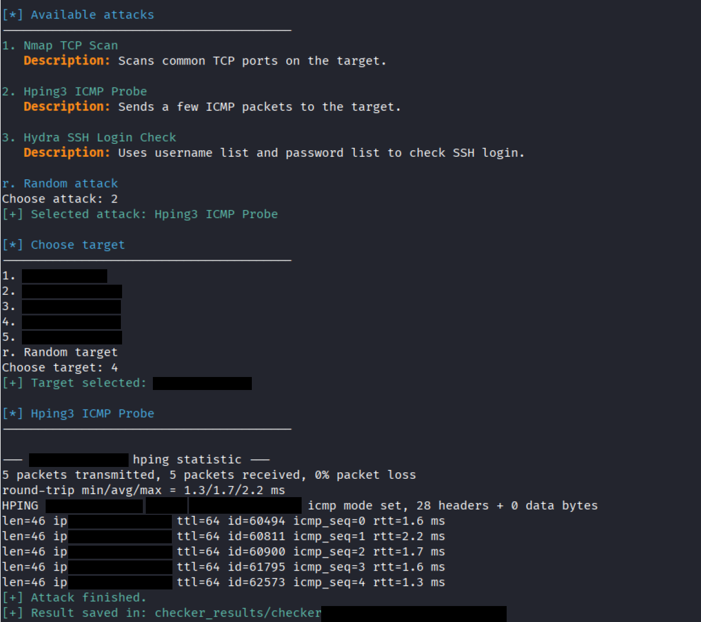
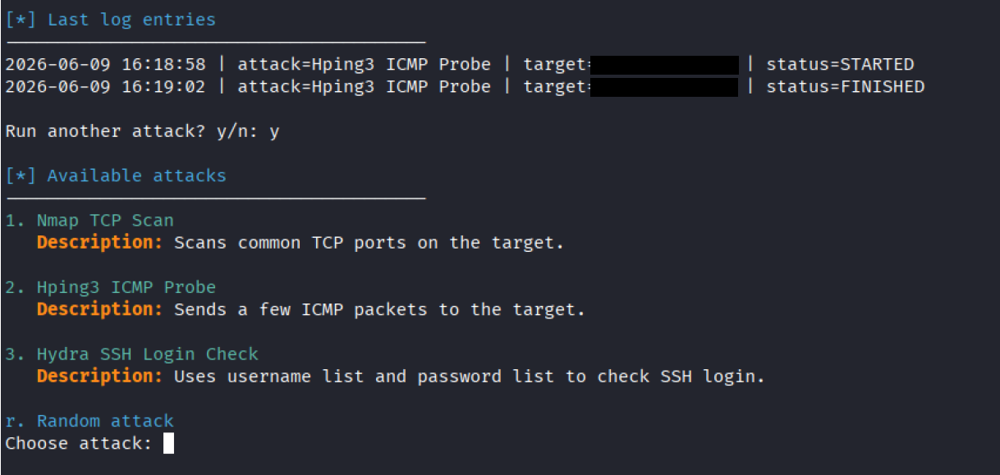
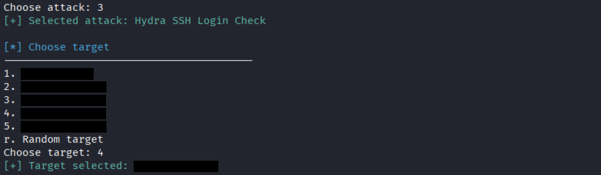
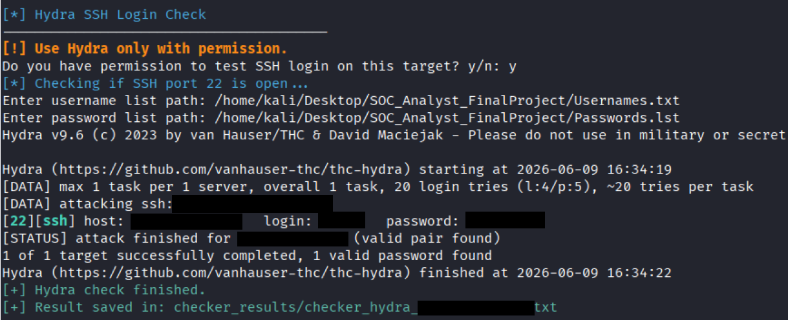
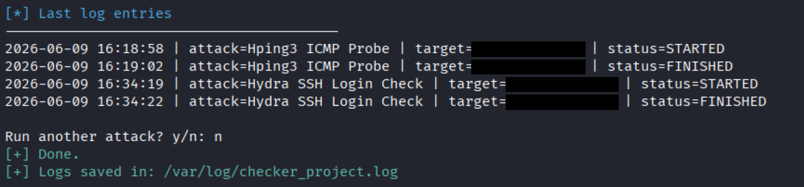

# Checker — Automated Security Activity Simulation

## Overview

Checker is a Bash-based security activity simulation tool developed as part of SOC Analyst training at ThinkCyber Bulgaria.

The script discovers active hosts on a user-supplied network and allows the operator to run one of three controlled activities against a selected host: an Nmap TCP scan, an Hping3 ICMP probe, or a Hydra SSH login check. The operator can select an activity and target manually or use random selection. Each activity is logged, and detailed command output is saved separately for review.

**Checker generates test activity and records its execution; it is not a SOC monitoring or intrusion detection system.** It is intended only for authorized laboratory environments.

## Features

- **Network Discovery:** Uses Nmap to find and list active hosts within a specified network range.
- **Activity Selection:** Provides three activities with descriptions and supports random selection.
- **Target Selection:** Allows manual selection from discovered hosts or random target selection.
- **Nmap TCP Scan:** Scans common TCP ports on the selected host.
- **Hping3 ICMP Probe:** Sends five ICMP packets to the selected host.
- **Hydra SSH Login Check:** Uses operator-supplied username and password lists after an additional permission prompt and a check that SSH port 22 is open.
- **Activity Logging:** Records timestamps, activity names, target IP addresses, and status values in `/var/log/checker_project.log`.
- **Result Files:** Saves detailed output in a local `checker_results/` directory.
- **Repeatable Workflow:** Lets the operator execute multiple activities in one session.

## Workflow

```text
Start Checker (sudo)
│
├── Confirm authorization
├── Check Nmap, Hping3, and Hydra
├── Prepare log and results directory
├── Enter network range
└── Discover active hosts
    │
    ├── Choose activity (or random)
    ├── Choose active target (or random)
    └── Execute selected activity
        ├── Nmap TCP Scan
        ├── Hping3 ICMP Probe
        └── Hydra SSH Login Check
            │
            ├── Log activity status
            ├── Save detailed output
            ├── Display recent log entries
            └── Run another activity? (y/n)
```

## Requirements

- Linux environment such as Kali Linux
- Bash
- Nmap
- Hping3
- Hydra
- Root privileges (`sudo`) to write to `/var/log` and run the required network operations

The script checks whether Nmap, Hping3, and Hydra are installed and offers to install missing packages using APT.

## Usage

Clone the repository:

```bash
git clone https://github.com/GeorgiKarliev/checker.git
cd checker
```

Make the script executable and run it:

```bash
chmod +x src/checker.sh
sudo ./src/checker.sh
```

The program then prompts you to:

1. Confirm that you have permission to test the network.
2. Enter a network range (CIDR, Nmap-style range, or wildcard format).
3. Choose an activity: `1` (Nmap), `2` (Hping3), `3` (Hydra), or `r` (random).
4. Choose a discovered target by number or `r` (random).
5. For Hydra, confirm permission again and provide paths to username and password lists.
6. Review the latest log entries and choose whether to run another activity.

**Important:** Run the tool only against hosts and networks you own or are explicitly authorized to test. The confirmation prompts record user acknowledgment; they do not independently verify permission.

## Supported Activities

### 1. Nmap TCP Scan

Runs a fast Nmap scan (`nmap -F`) of common TCP ports on the chosen host. The scan output is saved for review.

### 2. Hping3 ICMP Probe

Sends five ICMP packets (`hping3 -1 -c 5`) to the chosen host. Output is displayed in the terminal and saved to a file.

### 3. Hydra SSH Login Check

Checks whether TCP port 22 is open and, after an additional authorization prompt, uses supplied username and password lists to perform an SSH credential check. If the port is closed or the user declines, this activity is skipped and logged.

## Logging and Results

Checker records activity events in:

```text
/var/log/checker_project.log
```

Each log entry includes a timestamp, activity name, target IP address, and status, for example:

```text
YYYY-MM-DD HH:MM:SS | attack=Nmap TCP Scan | target=<LAB_IP> | status=FINISHED
```

Detailed tool output is written to the directory where the script is run:

```text
checker_results/
├── checker_nmap_<target>.txt
├── checker_hping3_<target>.txt
└── checker_hydra_<target>.txt
```

Files are generated for the activities actually executed. Checker displays the most recent ten entries from the main log after each activity.

**Privacy note:** Results and logs can contain IP addresses, service information, and, for successful Hydra checks, credential information. Do not publish raw outputs without reviewing and redacting them.

## Example Output

The following screenshots demonstrate Checker's workflow in an authorized laboratory environment. Sensitive network information and credentials have been redacted.

### Script Execution and Permission Check

Checker verifies authorization, checks the required tools, and prepares the activity log and results directory.



### Network Discovery

Nmap identifies active hosts within the selected network and displays them for target selection.



### Attack Selection and ICMP Simulation

The user selects an activity and target host. Hping3 performs an ICMP probe and saves the results.



### Activity Logging

Checker records the selected activity, target, timestamps, and execution status.



### SSH Assessment Target Selection

The user selects an available host for the authorized SSH login assessment.



### Hydra SSH Login Check

Hydra tests the supplied credential lists after authorization confirmation and an SSH port availability check.



### Final Results

The script displays the latest activity logs and confirms completion of the assessment session.



## Project Structure

```text
checker/
├── .gitattributes
├── .gitignore
├── README.md
├── src/
│   └── checker.sh
├── docs/
│   └── checker-report.pdf
└── images/
    ├── checker-execution.png
    ├── checker-network-discovery.png
    ├── checker-hping3.png
    ├── checker-activity-logs.png
    ├── checker-target-selection.png
    ├── checker-hydra.png
    └── checker-final-results.png
```

## Security and Privacy

- Intended for authorized security training and controlled simulations only.
- Requires an initial permission confirmation and an additional prompt before the Hydra SSH check.
- Reads credential lists from user-provided paths rather than embedding credentials in the source code.
- Stores command outputs separately from the summary activity log.
- Excludes generated results, logs, and common credential-list filenames from version control through `.gitignore`.
- Documentation and screenshots must be sanitized before public distribution.

## Known Limitations

- Network input checks accepted formats but does not fully validate IP octet values or CIDR boundaries.
- Nmap host discovery may miss hosts that do not respond to discovery probes.
- The Nmap activity uses a fast scan of common TCP ports, not a comprehensive port assessment.
- The Hping3 activity is a brief ICMP probe, not a traffic-load or denial-of-service test.
- The Hydra activity targets SSH on port 22 and depends on operator-supplied credential lists.
- Activity status logs document the tool's execution; they are not evidence that a SOC detected the activity.
- The script does not perform automated alerting, SIEM correlation, or intrusion detection.

## What I Learned

This project provided hands-on practice with:

- Bash scripting and menu-driven security automation
- Host discovery and basic TCP port scanning with Nmap
- ICMP probing with Hping3
- Controlled SSH credential checks with Hydra
- Logging execution events and organizing command outputs
- Designing repeatable lab activities relevant to SOC analysis

## Project Documentation

The complete project report explains the implementation, individual functions, and demonstration workflow:

[View Checker Project Report](docs/checker-report.pdf)

*The report should be reviewed and sanitized before the repository is made public.*

## Ethical Use

Checker is intended exclusively for educational use and authorized lab assessments. Do not run network scanning or credential checks against systems without explicit permission.

## Project Status

**Completed training project**

Developed as part of the SOC Analyst training at ThinkCyber Bulgaria.
